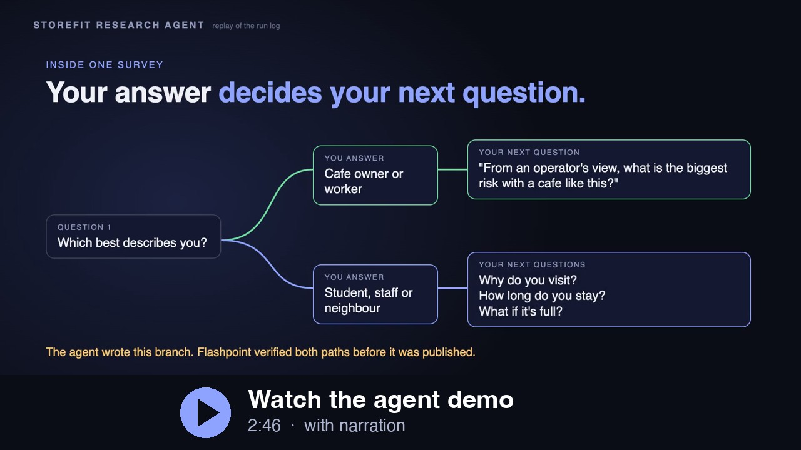
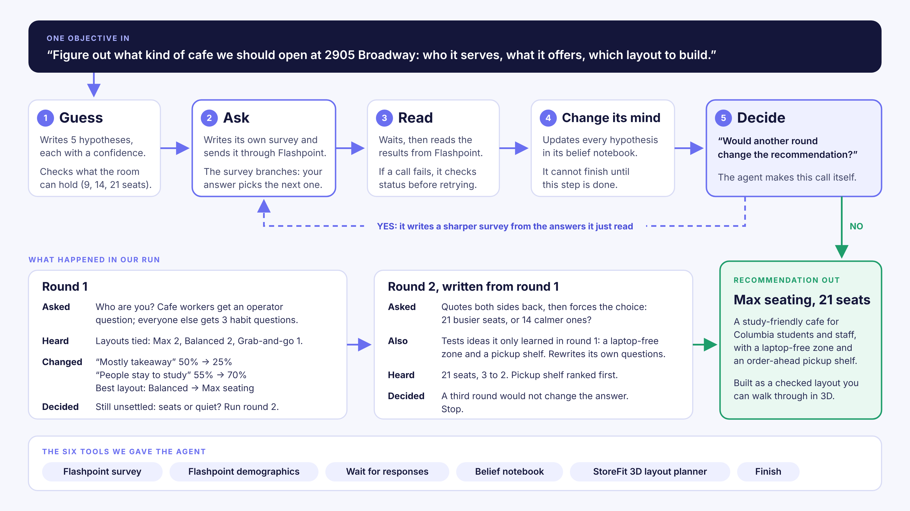

# StoreFit research agent · Flashpoint MCP Challenge

**One objective in. The agent runs its own research through the Flashpoint MCP and comes back with a decision.** It writes a survey, sends it, reads the answers, changes its mind, writes a sharper second survey about what is still open, and ends with a store layout you can walk through in 3D.

[](https://lzxgetoffearly-a11y.github.io/Flashpoint_Hackthon_StoreFit/agent-demo.mp4)

▶ **[Watch the demo video (2:39)](https://lzxgetoffearly-a11y.github.io/Flashpoint_Hackthon_StoreFit/agent-demo.mp4)** · **[Try the live app](https://lzxgetoffearly-a11y.github.io/Flashpoint_Hackthon_StoreFit/)** · [Agent code](agent/) · [Full run log](agent/runs/2026-11-22T05-58-32/REPORT.md)

## The objective we gave it
> Figure out what kind of cafe we should open in the vacant storefront at 2905 Broadway, next to Columbia University: who it should serve, what it should offer, and which layout to build.

That one sentence is the only instruction. Nobody told the agent which questions to ask. It decided on its own to run a follow-up round, and when to stop.

## The loop


## What the agent did, lap by lap
Everything below is from the run log (run `2026-11-22T05-58-32`, about 35 minutes).

**1. It started with guesses, and put a number on each.** Five hypotheses with a confidence level, before any data. For example: "demand is mostly quick takeaway" 50%, "a real group wants to sit and study for hours" 55%, "a balanced layout is the best fit" 40%.

**2. It checked what it could before asking anyone.** It ran StoreFit's own layout planner to see what the room can hold (9, 14 or 21 seats), and those three layouts became answer options in its survey. It also called Flashpoint `demographics` for the address to check who lives nearby. The data came back at county level (all of Manhattan), so the agent turned to its own survey for the local picture.

**3. Round 1: it designed a survey that adapts to the person answering.** The agent wrote the whole brief itself and chose the question types: single choice, a drag-to-rank of five seating styles, multi-select and open text.
- **Branching inside the survey.** The first question asks who you are, and that answer changes what you see next. Customers get three questions about their habits (why they come, how long they stay, what they do when the cafe is full). A cafe owner or worker skips those and instead gets an operator question: "From an operator's view, what is the biggest risk with a ~23×47 ft cafe like this?" Both paths then rejoin for the layout questions.
  ```text
  Q1  "Which best describes you?"
   ├─ Cafe owner or worker ──► "Biggest risk with a cafe like this?"
   │                            (the three customer questions are skipped)
   └─ Everyone else ─────────► "Why do you visit?"
                                "How long do you stay?"
                                "What if it's full?"
  Both paths rejoin for seating rank, layout choice, spend and open questions.
  ```
- It had Flashpoint run a survey check, then published and sent the invitations itself, passing two confirmation steps.
- Survey: https://flashpointopinions.com/bd639614-5465-45e7-836a-90255c3c9229

**4. It read the answers and changed its mind.** Round 1 came back split: Max seating 2, Balanced 2, Grab-and-go 1.

| Hypothesis | Before | After round 1 |
|---|---|---|
| Demand is mostly quick takeaway | 50% | **25%** |
| A real group wants to sit and study for hours | 55% | **70%** |
| Sofas are valued less than tables and banquettes | 35% | **60%** |
| Best layout | "Balanced" 40% | **replaced by "Max seating" 45%** |

It also named what was still unsettled: the people who chose Max cared about getting a seat, and the people who chose Balanced cared about quiet.

**5. Round 2: it wrote a sharper follow-up about exactly that disagreement.** This round was the agent's own decision.
- **It quoted round 1 back.** The new survey opens with both camps' own words ("more small tables so everyone can sit" against "fewer, nicer seats with a quiet corner") and then forces the trade-off: 21 busier seats, or 14 calmer ones?
- **It corrected its own questions while writing them.** Mid-brief it wrote "Wait—instead ask" and replaced a vague question with a concrete trade-off. It also swapped a 0–10 slider for a plain Yes / Maybe / No.
- **It asked about things it had only learned in round 1.** A laptop-free zone and an order-ahead pickup shelf both came from round-1 open answers.
- **New branching.** Owners and workers skip two customer questions and get "At peak, how many staff do you think a cafe this size needs behind the counter?"
- Survey: https://flashpointopinions.com/55d4c1dc-fa98-4676-a65b-3be8b2c1f8b0

**How round-1 answers became round-2 questions:**

| What it heard in round 1 | What it asked in round 2 | What came back |
|---|---|---|
| Layouts tied: Max 2, Balanced 2, Grab-and-go 1 | A forced choice: 21 busier seats or 14 calmer ones? | 21 seats, 3 to 2 |
| "Sofas look nice but one person holds three seats" | Would you swap the sofa for 4–5 more tables? | Split: 2 yes, 2 no, 1 no difference |
| Some wanted a quiet corner to work in | Should part of the room be laptop-free at peak? | A third of seats, 3 of 5 |
| The cafe worker warned that the class-change rush blocks the door | Which service features matter most, including a pickup shelf away from the seats? | Pickup shelf first, 3 of 5 |

Follow one chain from start to end: **answering "cafe owner or worker" unlocked the operator question → that answer exposed the queue problem → the agent tested a pickup shelf in round 2 → it came top → it is in the final recommendation.**

**6. It handled a failure without help.** The send call for round 2 timed out after 600 seconds. Instead of sending again blindly, the agent asked Flashpoint for the status first, and Flashpoint reported the 7 invitations as sent. When its first read of the results showed no answers yet, it waited and read again.

**7. It decided when to stop, and criticised its own work.** Round 2 went 3 to 2 for the 21-seat room. The agent raised "Max seating is best" to 55%, added a new hypothesis (a laptop-free zone and a pickup shelf are worth building, 55%), and judged that "a third round would not change the recommendation", so it stopped with one round of its limit unused. In its report it flags its own mistakes: one round-1 question described Max as "more crowded", which may have biased answers, and one round-2 question was clumsily worded.

**8. Final recommendation.** A study-friendly, seat-rich neighbourhood cafe for Columbia students and staff, with outlets at tables, a laptop-free zone and an order-ahead pickup shelf kept away from the seating, built as the **Max seating** layout (21 seats). The agent states that this won by a single vote, and that the layout still fails the one-exit check and needs a design professional.

## How we tested it
We had AI play five personas to answer each survey: an undergraduate, a graduate student, a university staff member, a neighbourhood resident and a cafe worker. The agent read those test responses, revised its hypotheses, wrote a sharper second survey on the question still open, got a new round of answers from the same five personas, and then chose the layout. Answering in different personas let us verify that the whole loop runs end to end. With a real panel, or a larger survey, the same code runs unchanged.

## Run it
Node 20+. More options in [`agent/README.md`](agent/README.md).
```bash
cd agent && npm install
cp .env.example .env      # add your Flashpoint wallet key and Anthropic key; .env is git-ignored
node agent.mjs --objective "your one objective"
node agent.mjs --dry-run  # rehearse without sending email or spending USDC
```

Run logs are in [`agent/runs/2026-11-22T05-58-32/`](agent/runs/2026-11-22T05-58-32/): `REPORT.md` has every decision, every brief the agent wrote, every Flashpoint reply and the payment receipts; `log.jsonl` is the raw event log.

## What we built
Code in [`agent/`](agent/).
- **An agent loop with six tools:** Flashpoint surveys, Flashpoint demographics, waiting for responses, a belief notebook, StoreFit's 3D layout planner, and finish.
- **Learning is enforced:** the agent cannot finish until it has updated its notebook with the latest results.
- **Research connected to a real decision:** the layout planner is one of its tools, so the answer is a checked store you can walk through in 3D, not a paragraph.
- **Safe autonomy:** budget and round limits in code, a full decision log, and a resume that never blindly resends a survey.

## StoreFit, the product the agent plugs into
StoreFit helps a first-time owner open a small cafe in New York: it ranks real vacant storefronts near Columbia on live NYC open data, then fits a counter, queue and seats into the chosen space in 3D and checks them against accessibility and building rules. The agent uses that layout planner as one of its tools.

- **Live app:** https://lzxgetoffearly-a11y.github.io/Flashpoint_Hackthon_StoreFit/ (no install or login; click **Start a search**, pick **2905 Broadway**, then **Fit a cafe in this space**)
- **Everything else about the product** (how it works, data sources, business model, the main-track write-up, how to run it locally, credits): [`docs/STOREFIT.md`](docs/STOREFIT.md)
