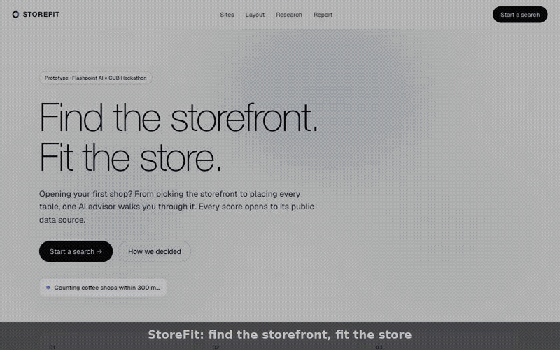

# StoreFit — find the storefront, fit the store

**Two things are in this repo:**
1. **The MCP Challenge agent:** one objective in, and an AI agent runs its own Flashpoint surveys, follows up, and picks a store layout. [Jump to it](#mcp-challenge-a-research-agent-that-runs-its-own-surveys).
2. **StoreFit, the product:** a site-selection and 3D layout tool for first-time shop owners, which the agent plugs into. [Jump to it](#storefit-the-product).

**▶ Agent demo video (2:39):** [watch `storefit-agent-demo-narrated.mp4`](https://github.com/lzxgetoffearly-a11y/flashpoint-hackthon/raw/main/demo-assets/storefit-agent-demo-narrated.mp4) · script: [`NARRATION.md`](demo-assets/NARRATION.md). It shows the agent loop from the saved run log, then the store it chose in 3D. The voice-over is synthesized.

## ▶ Live demo: https://lzxgetoffearly-a11y.github.io/flashpoint-hackthon/
No install or login. Open the link in Chrome on a laptop, click **Start a search**, pick **2905 Broadway**, then **Fit a cafe in this space**. (Hosted on GitHub Pages from the `gh-pages` branch, built from `main`.)

### Product demo video (75 s, the web app without the agent)
[](https://lzxgetoffearly-a11y.github.io/flashpoint-hackthon/demo.mp4)

Click the preview to watch the MP4 ([direct link](https://lzxgetoffearly-a11y.github.io/flashpoint-hackthon/demo.mp4)). Recorded step by step on the live site; every screen shows real data. It ends with clicking a piece of furniture, the shopping list, and the retailer product page the link opens.

Engineering & Product track · Flashpoint AI × CUB Hackathon (Nov 13–21, 2026)

StoreFit helps a first-time owner open a small cafe in New York. It ranks **real vacant storefronts** near Columbia using **live NYC open data**, explains every score with its source, and then runs a **layout agent** that fits a counter, queue and seats into the chosen space in 3D, checking aisles and overlaps.

> Status: prototype. Scores use public data (food businesses, coffee competitors, subway distance and station ridership), not pedestrian counts or real rents. Unit sizes are estimates from city lot data that the user can overwrite; rent is a user input. See [SPEC.md](SPEC.md).

## MCP Challenge: a research agent that runs its own surveys
We give an AI agent one sentence and it does the research itself through the Flashpoint MCP: it decides what to ask, builds and publishes the survey, emails our panel, reads the results, decides whether a follow-up round is needed, and ends by choosing one of StoreFit's existing layouts for the storefront. Code: [`agent/`](agent/). How to run it: [`agent/README.md`](agent/README.md).

**How we tested the loop.** We had AI play five personas to answer each survey: an undergraduate, a graduate student, a university staff member, a neighbourhood resident and a cafe worker. The agent read those test responses, revised its hypotheses, wrote a sharper second survey on the question still open, got a new round of answers from the same five personas, and then chose the layout. Answering in different personas let us verify that the whole loop runs end to end. With a real panel, or a larger survey, the same code runs unchanged.

**Objective given to the agent:**
> Figure out what kind of cafe we should open in the vacant storefront at 2905 Broadway, next to Columbia University: who it should serve, what it should offer, and which layout to build.

**What the agent did, lap by lap.** Nobody told it which questions to ask, how many rounds to run, or when to stop. Everything below is from the run log (run `2026-11-22T05-58-32`, about 35 minutes).

**1. It started with guesses, and put a number on each.** Five hypotheses with a confidence level, before any data. For example: "demand is mostly quick takeaway" 50%, "a real group wants to sit and study for hours" 55%, "a balanced layout is the best fit" 40%.

**2. It checked what it could before asking anyone.** It ran StoreFit's own layout planner to see what the room can hold (9, 14 or 21 seats), and those three layouts became answer options in its survey. It also called Flashpoint `demographics` for the address to check who lives nearby. The data came back at county level (all of Manhattan), so the agent turned to its own survey for the local picture.

**3. Round 1: it designed a survey that adapts to the person answering.** The agent wrote the whole brief itself and chose the question types: single choice, a drag-to-rank of five seating styles, multi-select and open text.
- **Branching inside the survey.** The first question asks who you are, and that answer changes what you see next. Customers get three questions about their habits (why they come, how long they stay, what they do when the cafe is full). A cafe owner or worker skips those and instead gets an operator question: "From an operator's view, what is the biggest risk with a ~23×47 ft cafe like this?" Both paths then rejoin for the layout questions.
  ```text
  Q1  "Which best describes you?"
   ├─ Cafe owner or worker ──► "From an operator's view, what is the biggest risk with a ~23×47 ft cafe like this?"
   │                            (the three customer questions are skipped)
   └─ Everyone else ─────────► "Why do you visit?" → "How long do you stay?" → "What if it's full?"
  Both paths rejoin for seating rank, layout choice, spend and open questions.
  ```
- It had Flashpoint run a survey check, then published and sent the invitations itself, passing two confirmation steps.
- Survey: https://flashpointopinions.com/bd639614-5465-45e7-836a-90255c3c9229

**4. It read the answers and changed its mind.** Round 1 came back split: Max seating 2, Balanced 2, Grab-and-go 1.

| Hypothesis | Before | After round 1 |
|---|---|---|
| Demand is mostly quick takeaway | 50% | **25%** |
| A real group wants to sit and study for hours | 55% | **70%** |
| Sofas are valued less than tables and banquettes | 35% | **60%** |
| Best layout | "Balanced" 40% | **replaced by "Max seating" 45%** |

It also named what was still unsettled: the people who chose Max cared about getting a seat, and the people who chose Balanced cared about quiet.

**5. Round 2: it wrote a sharper follow-up about exactly that disagreement.** This round was the agent's own decision.
- **It quoted round 1 back.** The new survey opens with both camps' own words ("more small tables so everyone can sit" against "fewer, nicer seats with a quiet corner") and then forces the trade-off: 21 busier seats, or 14 calmer ones?
- **It corrected its own questions while writing them.** Mid-brief it wrote "Wait—instead ask" and replaced a vague question with a concrete trade-off. It also swapped a 0–10 slider for a plain Yes / Maybe / No.
- **It asked about things it had only learned in round 1.** A laptop-free zone and an order-ahead pickup shelf both came from round-1 open answers.
- **New branching.** Owners and workers skip two customer questions and get "At peak, how many staff do you think a cafe this size needs behind the counter?"
- Survey: https://flashpointopinions.com/55d4c1dc-fa98-4676-a65b-3be8b2c1f8b0

**How round-1 answers became round-2 questions:**

| What it heard in round 1 | What it asked in round 2 | What came back |
|---|---|---|
| Layouts tied: Max 2, Balanced 2, Grab-and-go 1 | A forced choice: 21 busier seats or 14 calmer ones? | 21 seats, 3 to 2 |
| "Sofas look nice but one person holds three seats" | Would you swap the sofa for 4–5 more tables? | Split: 2 yes, 2 no, 1 no difference |
| Some wanted a quiet corner to work in | Should part of the room be laptop-free at peak? | A third of seats, 3 of 5 |
| The cafe worker warned that the class-change rush blocks the door | Which service features matter most, including a pickup shelf away from the seats? | Pickup shelf first, 3 of 5 |

Follow one chain from start to end: **answering "cafe owner or worker" unlocked the operator question → that answer exposed the queue problem → the agent tested a pickup shelf in round 2 → it came top → it is in the final recommendation.**

**6. It handled a failure without help.** The send call for round 2 timed out after 600 seconds. Instead of sending again blindly, the agent asked Flashpoint for the status first, and Flashpoint reported the 7 invitations as sent. When its first read of the results showed no answers yet, it waited and read again.

**7. It decided when to stop, and criticised its own work.** Round 2 went 3 to 2 for the 21-seat room. The agent raised "Max seating is best" to 55%, added a new hypothesis (a laptop-free zone and a pickup shelf are worth building, 55%), and judged that "a third round would not change the recommendation", so it stopped with one round of its limit unused. In its report it flags its own mistakes: one round-1 question described Max as "more crowded", which may have biased answers, and one round-2 question was clumsily worded.

**8. Final recommendation.** A study-friendly, seat-rich neighbourhood cafe for Columbia students and staff, with outlets at tables, a laptop-free zone and an order-ahead pickup shelf kept away from the seating, built as the **Max seating** layout (21 seats). The agent states that this won by a single vote, and that the layout still fails the one-exit check and needs a design professional.

**What we built to make this possible** (code in [`agent/`](agent/)):
- **An agent loop with six tools:** Flashpoint surveys, Flashpoint demographics, waiting for responses, a belief notebook, StoreFit's 3D layout planner, and finish.
- **Learning is enforced:** the agent cannot finish until it has updated its notebook with the latest results.
- **Research connected to a real decision:** the layout planner is one of its tools, so the answer is a checked store you can walk through in 3D, not a paragraph.
- **Safe autonomy:** budget and round limits in code, a full decision log, and a resume that never blindly resends a survey.

**Run it** (Node 20+; more options in [`agent/README.md`](agent/README.md)):
```bash
cd agent && npm install
cp .env.example .env      # add your Flashpoint wallet key and Anthropic key; .env is git-ignored
node agent.mjs --objective "your one objective"
node agent.mjs --dry-run  # rehearse without sending email or spending USDC
```

**Run logs:** [`agent/runs/2026-11-22T05-58-32/`](agent/runs/2026-11-22T05-58-32/). `REPORT.md` has every decision, every brief the agent wrote, every Flashpoint reply and the payment receipts; `log.jsonl` is the raw event log.


# StoreFit, the product

## Why this matters
- **Roughly 50 million new businesses start worldwide every year: about 137,000 a day, or about 95 every minute.** This is a widely cited industry estimate, not an official count. (A stricter measure, registered limited-liability companies, is about 4.3 per 1,000 working-age adults a year across 188 economies ([World Bank, 2026](https://blogs.worldbank.org/en/psd/a-global-snapshot-of-entrepreneurship-trends)).)
- In the US alone, about **497,000 business applications** were filed in December 2025, about **16,000 a day** ([US Census Business Formation Statistics](https://www.census.gov/econ/bfs/pdf/historic/bfs_2025m12.pdf)).
- Many of these founders have to answer the same two questions before signing a lease: *Is this the right location?* and *Will my store actually fit inside it?* Today they answer them with broker tours, guesswork and a tape measure.

## How it works
StoreFit is a **location-intelligence engine plus a 3D spatial-planning agent**.

**1. Multi-source data fusion.** For every candidate storefront, StoreFit queries city and transit open data live, then joins the results on location:
- NYC Open Data: vacant storefronts (Local Law 157), the DOHMH restaurant inspection registry, and PLUTO tax-lot geometry
- MTA: subway station locations and hourly station ridership
- USGS 3DEP aerial LiDAR point clouds, and Google Photorealistic 3D Tiles

**2. Explainable site scoring.** A weighted multi-factor model combines five signals into one 0–100 score:
- demand density (nearby food activity)
- competitive saturation (a non-linear curve: a few competitors confirm demand, more split it)
- transit accessibility (walking distance blended with station ridership)
- build-out readiness (previous use of the unit)
- rent-to-revenue ratio

Every factor shows its raw value, its rule and its source, so the score is a decision aid, not a black box. In our 5-person Flashpoint pilot, trust in an automatic score was low (2.8 / 5), which is why we kept it this way.

**3. Spatial reconstruction.** StoreFit estimates each unit's footprint from lot geometry and orients the storefront from the LiDAR point cloud. This gives a 3D model of the real block.

**4. Constraint-solving layout agent.** The agent places the counter, back of house, queue and seating. It checks every layout against accessibility and egress codes (ADA 2010, IBC / NYC Building Code) and treats each dimension as a range, not a single number. Each layout gets a verdict: **Works**, **Tight**, **Fails** or **Needs measuring**.

## What to try
Use **2905 Broadway** for the walkthrough; it is the address we checked end to end.

1. **Start a search.** Eight storefronts reported vacant near Columbia load with live numbers from NYC and MTA open data (a few seconds). Click a card to see each factor, its raw value and its source. Competitors show on the map; the Satellite and Street View toggles show the real place.
2. **Fit a cafe in this space** opens the **Fit Lab**.
   - The room size is estimated per address from PLUTO (ground-floor retail area ÷ storefronts on the lot), so each address gets a different plan. Type measured dimensions to replace it.
   - The agent lays out a counter and back of house, a window bar, a wall banquette with two-tops, a lounge corner and free-standing tables, and keeps a straight 1.2 m aisle from the door to the counter.
   - Every number has a range, a method and a source. Verdicts use the whole range: **Works**, **Tight**, **Fails**, or **Needs measuring** (ceiling height). Open a check and drag its slider to move the wall or chairs inside the margin.
   - Three layouts: Your brief, Grab-and-go, Max seating.
   - Views: Overview, Top, Street, Inside, Walk in. Context layers in Overview: **Block** (building massing from LiDAR), **LiDAR** (the raw point cloud), **Google 3D** (photorealistic tiles, needs a key).
   - Click any furniture for its product page; "Furniture and equipment" totals list prices.
3. **Research** shows how Flashpoint findings shaped each rule. **Report** prints a one-page summary.

## Business model
The Fit Lab places real, purchasable furniture and equipment into the owner's actual space. Each item links to its product page, and the shopping list totals the list prices. That makes it a sales channel for manufacturers:
- **Manufacturers and suppliers** (furniture, seating, coffee and refrigeration equipment) pay to have their catalog as 3D models inside the Fit Lab. Their products then get "demoed" in thousands of real storefronts before purchase, which shortens the sales cycle and cuts returns from items that don't fit.
- **Revenue:** a per-SKU listing fee, plus a referral commission on orders placed from the shopping list.
- **Owners** use site search and layout for free. A paid, detailed report can be added later.

This model is a hypothesis. Our next research step is to interview suppliers and owners to test it.

# Hackathon write-up and reference

## How we use Flashpoint AI
Status (Nov 21): **we ran a Flashpoint survey of our own first-party panel; the results are below.** It is an early pilot with five people we know, so we read it as directional.

What we actually did with Flashpoint:
- Connected the Flashpoint MCP tools with the team's Base USDC wallet (funded with 25 USDC).
- Built, published and sent a 5-question survey to our own first-party panel, "StoreFit testers" (real people we invited, no third-party sample): https://flashpointopinions.com/bdcdb46f-cd9d-4e09-91e1-25ccd022274e
- Cost: $2.50 over 5 paid calls. On-chain receipts:
  [create](https://basescan.org/tx/0x0e4dd2a3bd01d379aad04ec537128bb5b3f7a50a973f357bef96fb89da00dd01) ·
  [confirm](https://basescan.org/tx/0xb7aaaddc7c6988cbc25f6f89e31846f0f4b3074fdb724584e7c5187c4d797cb0) ·
  [publish](https://basescan.org/tx/0x9f38091424d68d05dda84387331c069c3ed5d6ef73469399da9e627df365c64f) ·
  [send](https://basescan.org/tx/0x8dfb3b8b11e7ce38ecfd36243be76eb5027e4e63dcf33c3ebc17e289be4653fe) ·
  [results](https://basescan.org/tx/0x3875a8715af24eed2a4511673806f9c39a68991be0998a7de4966d64f44f606d) (total $2.50)

### Survey results (Flashpoint pilot, % of respondents)
| Question | Result |
|---|---|
| Who are you | 60% run or plan to open a small shop/cafe · 40% customers |
| What matters most when judging a location (multi) | Rent worth it 80% · Equipment and seating fit 60% · Nearby customers (students, workers) 60% · Foot traffic 20% · Competition 0% |
| How helpful is a 3D layout preview before signing (1–5) | **3.8 / 5** (80% rated it 4 or 5) |
| How much do you trust an automatic site score (1–5) | **2.8 / 5** (only 20% rated it 4 or 5; 80% rated it 2–3) |

Open answers, verbatim:
1. "As a customer I notice when the entrance is awkward or the queue blocks the seats. A shop should be easy to reach and comfortable to use not just look good in pictures. I have no experience signing a commercial lease so I cannot judge the business economics."
2. "I think the biggest mistake is to combine a lot of things together. For example: How many people walk across your store / What percentage of those people are your target customers / How much of that is your main target. You also need to consider seasonal effects. For example, if you are selling something pretty hot and the weather is cool, you will probably sell much more than in the summer. So yeah, there are a lot of things you need to combine together."
3. "Mistaking a busy street for enough paying customers. Before signing my first cafe lease I would count traffic at different times check whether those people would buy coffee and work out how many daily sales cover rent. A nice layout would not fix weak demand."
4. "Moving for a lower rent without checking whether regular clients can still get there easily. I would also measure the space for nail stations ventilation and a private treatment area before agreeing to the lease. More floor area is not useful if the working layout is awkward."
5. "Signing a lease before checking kitchen equipment ventilation and electrical capacity. Cheap rent can hide expensive fit-out work. I would verify the layout and renovation costs with a contractor before committing to a second food shop."

### What the results changed
- **Kept:** the Fit Lab as the lead feature. "Will my equipment and seating fit" is a top-two concern (60%), and 80% rated the 3D preview 4 or 5 (avg 3.8/5).
- **Reinforced:** every score shows its source and range instead of a bare number. Trust in an automatic score was low (2.8/5; only 20% rated it 4 or 5), so a black-box score would not be used.
- **Ruled out as a headline:** foot traffic alone (20%) and competitor counts (0%). Rent worth it is the top concern (80%). Answers 2 and 3 say a busy street is not the same as paying customers, so the next step is a demand-vs-rent check (daily sales needed to cover rent), not a bigger traffic number.
- **Added to the Fit Lab backlog (not built yet):** entrance and queue path not blocking seats (answer 1); ventilation and electrical capacity flags (answers 4 and 5); target-customer share and seasonality in the demand check (answer 2); access for existing regulars when relocating (answer 4).

Each question is tied to a product decision:

| Survey question | Decision it will drive |
|---|---|
| Who are you (owner / planning to open / customer) | Which user the product is written for |
| What matters most when judging a storefront's location | Weights of the site score (`src/lib/score.js`) |
| How much would a 3D layout preview help before signing (1–5) | Whether the Fit Lab stays the lead feature |
| How much do you trust an automatic site score (1–5) | How much source and range detail we show on every number |
| The mistake you most want to avoid when choosing a space (open) | Which checks the Fit Lab runs |

Not done for this pilot survey: no synthetic panel was run, no AI-moderated interviews, and Flashpoint demographics are not used in the scores. The score weights and layout rules in this build are our own starting assumptions plus cited codes (ADA 2010, IBC / NYC Building Code), not survey results.

<details>
<summary><b>Main-track write-up: the six required questions (click to expand)</b></summary>

- **Problem and audience:** A first-time owner has to commit to a lease before knowing two things: whether the location has demand without too much competition, and whether the counter, queue and seats they need will fit legally in that unit. Our intended user is a first-time independent cafe owner near Columbia. This is our hypothesis; the survey's first and last questions are there to test it.
- **Use of Flashpoint (question + evidence):** Question: "what do people opening a small shop find hardest to judge, and do a 3D fit preview and a sourced score help?" Evidence: survey sent to our first-party panel; results and receipts above.
- **Impact of decisions (changed / kept / ruled out):** Kept the Fit Lab as the lead feature; kept sources and ranges on every score because trust in automatic scores was low; ruled out foot traffic and competitor counts as headline metrics; added entrance/queue, ventilation and electrical checks and a sales-vs-rent check to the backlog. Early pilot, so directional.
- **Proposed solution:** live-data site shortlist + 3D layout agent (this repo).
- **Supporting evidence (what was actually tested vs simulated):** Real: live NYC / MTA open-data queries, USGS LiDAR, PLUTO lot data, Google 3D tiles, product pages and list prices, and the pilot survey above, answered by people on our first-party panel. Estimated or assumed, and labelled so in the app: unit dimensions (from lot data), ceiling height, door position. Simulated: the pilot survey has no synthetic respondents and no fabricated results. The MCP Challenge agent run is different and is labelled as such: its surveys were answered only by AI-generated test-persona responses submitted by our AI assistant, with 0 independent human respondents, so it demonstrates the agent and is not evidence of demand. The layout itself is generated by rules, not validated with owners.
- **Limitations and next steps:** no pedestrian counts or rent data; unit size is an estimate from lot data (±0.6 m) until someone measures; ceiling height is assumed; the layout is rule-generated with one counter position (across the back) and needs professional review; the Google 3D facade alignment was checked on 2905 Broadway only. Next: store-type templates (side counter, loop circulation), listing integration, floor-plan upload, interviews with owners.

</details>

## Run locally
Prerequisites: Node.js 18+ and npm.
```bash
npm install
npm run dev        # open the printed localhost URL
npm run build      # static build in dist/
```
Environment variables (optional — without them the agent uses its built-in rule parser):
```bash
cp .env.example .env
# VITE_LLM_BASE_URL, VITE_LLM_API_KEY, VITE_LLM_MODEL (any OpenAI-compatible endpoint)
# VITE_GOOGLE_MAPS_KEY (optional): Google Maps Platform key with the Map Tiles API enabled.
#   Turns on the "Google 3D" toggle in the Fit Lab. Restrict the key to your site by HTTP referrer.
```
Never commit `.env`. Note: `VITE_` variables are bundled into the client — use a throwaway key for demos only.

## Data sources
- [Storefronts Reported Vacant or Not](https://data.cityofnewyork.us/City-Government/Storefronts-Reported-Vacant-or-Not/92iy-9c3n) (NYC Local Law 157) — candidate list, reporting year 2025
- [DOHMH Restaurant Inspection Results](https://data.cityofnewyork.us/Health/DOHMH-New-York-City-Restaurant-Inspection-Results/43nn-pn8j) — competitors, food activity (live)
- [MTA Subway Stations](https://data.ny.gov/Transportation/MTA-Subway-Stations/39hk-dx4f) — transit access (live)
- Offline fallback: `src/data/snapshot.json` holds the same queries' results captured 2026-11-21 06:42 UTC; the UI labels it "snapshot" whenever it is used.
- [USGS 3DEP LiDAR, NY_NewYorkCity (2017)](https://registry.opendata.aws/usgs-lidar/) — public domain, Entwine Point Tiles on AWS Open Data. `scripts/lidar_export.py` cuts a 200 m square around each candidate into `public/lidar/*.bin` (int16 decimetres). Shop orientation is detected from the points (nearest street face) and is approximate.
- Fit-check rules: ADA 2010 Standards §403.5.1, §404.2.4.1, §307.4, §902; IBC / NYC Building Code Tables 1004.5 and 1006.2.1.
- Map tiles © OpenStreetMap contributors; satellite imagery © Esri, Maxar, Earthstar Geographics. Street view is Google's public embed.
- Product links and list prices: read from ikea.com and webstaurantstore.com search results on 2026-11-21 (`src/data/products.js`). Only the sofa and pendant are the exact modeled products (Wayfair); the rest are labeled "similar product".

Added in the last round:

- **NYC PLUTO** (`64uk-42ks`): building frontage, depth and ground-floor retail area for each lot. The Fit Lab divides the lot's retail area by the number of storefronts reported on that lot to estimate the unit's size. This is an estimate, labelled as such, with a ±0.6 m range on each wall; the user can type measured dimensions instead.
- **MTA Subway Hourly Ridership** (`5wq4-mkjj`, data.ny.gov): entries per day at the nearest station, averaged over the week of Oct 5–11, 2026. It is half of the subway factor; the other half is walking distance.
- **Google Photorealistic 3D Tiles** (Map Tiles API, needs a key): the real block around the storefront, shown with the "Google 3D" toggle. The column above the unit is cut away so the plan is visible.
- **USGS 3DEP LiDAR** is now exported at the survey's full density (about 8 points per m², 260–320k points per site).

<details>
<summary><b>Credits and disclosures (click to expand)</b></summary>

- The web app, data wiring and pilot research in this repo were done during Nov 13–21, 2026. The MCP Challenge agent (`agent/`) was built and run on Nov 21–22, 2026.
- 3D models (realistic, from [Khronos glTF-Sample-Assets](https://github.com/KhronosGroup/glTF-Sample-Assets)):
  - GlamVelvetSofa — © 2021 Wayfair LLC, CC-BY 4.0 (a real Wayfair product; linked as "Buy on Wayfair")
  - AnisotropyBarnLamp — © 2023 Wayfair LLC, CC-BY 4.0 (a real Wayfair product; linked as "Buy on Wayfair")
  - SheenChair — © 2020 Wayfair LLC, CC0
  - DiffuseTransmissionPlant — © 2024 Darmstadt Graphics Group, CC-BY 4.0
  - DiffuseTransmissionTeacup — CC0
  - Tables, chairs, stools, counter, espresso machine, fridge, sink and shelves are procedural three.js models we wrote with PBR materials. They are generic, so each links to one specific comparable product page, labeled "similar product".
- Libraries: React, three.js, @react-three/fiber, drei, Leaflet, Vite (MIT/BSD).
- Visual style inspired by public startup landing pages; no assets copied.
- AI tools: Flashpoint AI (primary, research). Claude was used as a coding assistant for scaffolding this prototype.

</details>
